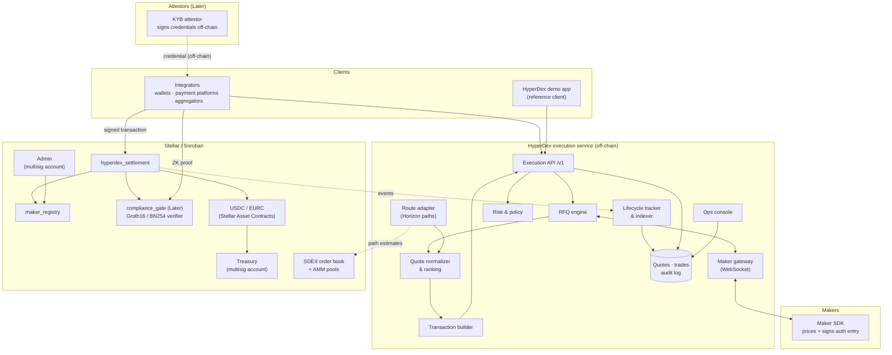
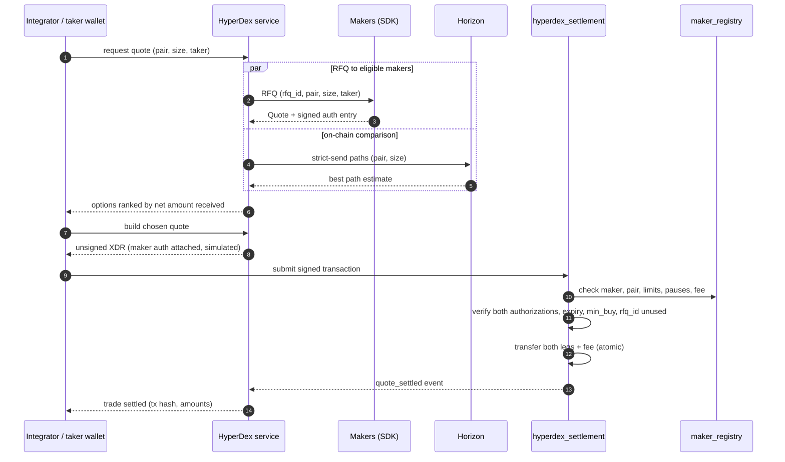
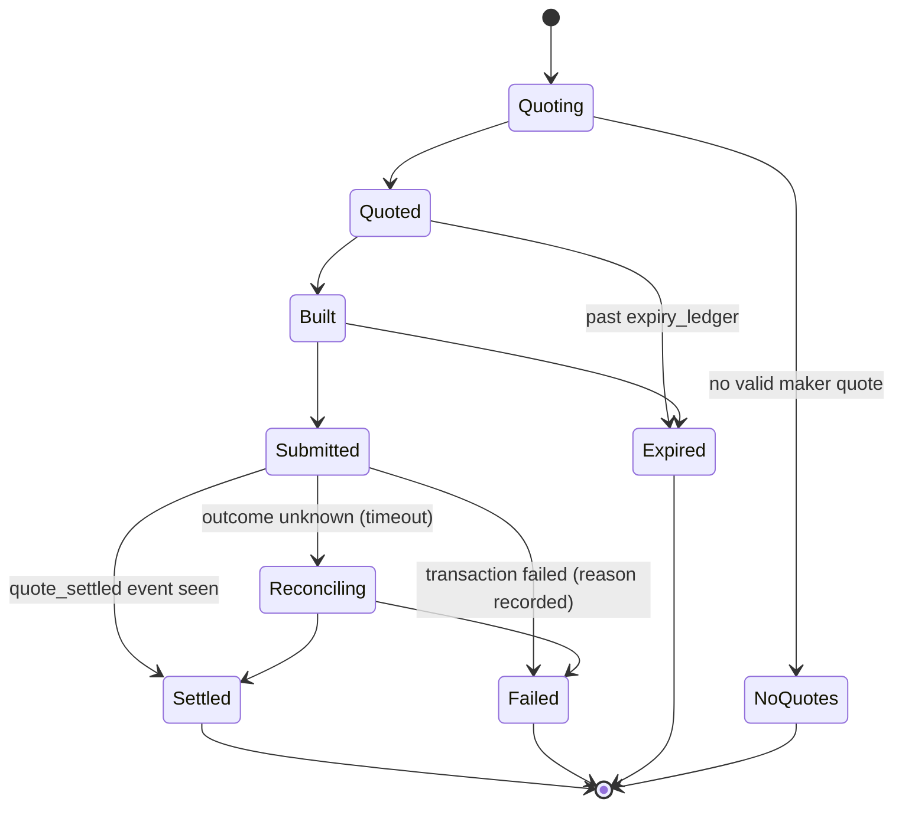

# HyperDex — Target Architecture

> **What this document is.** The architecture HyperDex is building toward: an RFQ liquidity and
> settlement layer for stablecoin FX on Stellar. It is a design, not a description of deployed
> code. The system as built today (v2) is described in
> [`TECHNICAL_ARCHITECTURE.md`](TECHNICAL_ARCHITECTURE.md). Every component below carries a status:
>
> | Status | Meaning |
> |---|---|
> | **Built (v2)** | Exists in this repository today, on Stellar Testnet |
> | **v3** | Next build: new settlement contracts and maker signing, deployed fresh to testnet |
> | **Next** | Follows v3: the integrator-facing execution API and lifecycle tracking |
> | **Later** | After real usage justifies it: business tooling, smart-account makers, audit |
>
> HyperDex runs on Stellar Testnet only. The contracts are not yet independently audited.

---

## 1. What HyperDex Is

**HyperDex is an RFQ liquidity and settlement layer for stablecoin FX on Stellar.** Professional
makers quote firm prices for the exact size requested. Each quote is compared against Stellar's own
liquidity (the SDEX order book and AMM pools reached through path payments). The chosen trade
settles atomically on Soroban, wallet to wallet, at the signed price, or not at all.

HyperDex adds a liquidity *source* that Stellar does not have today: **signed, size-specific quotes
from professional makers**. It is designed to be consumed by others:

| Who | Role | What they get |
|---|---|---|
| **Makers** (OTC desks, market makers, treasury desks) | Supply quotes | Order flow without locking capital in pools; funds stay in their own accounts |
| **Integrators** (wallets, payment platforms, fintech APIs, aggregators) | Request and settle trades for their users | One API for firm USDC↔EURC conversion, with the best on-chain route shown alongside |
| **End businesses and users** | Reached through integrators | A known amount out before they sign |

**What HyperDex is not:**
- A retail DEX or an AMM.
- A custodian: no funds ever sit with HyperDex.
- A replacement for SDEX, Soroswap, Aquarius or the aggregators. HyperDex is measured against them,
  and is built so that routers can treat its makers as one more venue.

### Design principles
1. **Settlement is on-chain and minimal.** The contract checks the signed terms and moves both legs
   atomically. Everything that can be off-chain (pricing, ranking, routing) is off-chain.
2. **Use Stellar's own primitives.** Soroban authorization (the official atomic-swap pattern), Stellar
   Asset Contracts, Horizon path finding, multisig accounts. No custom signature schemes.
3. **Non-custodial by construction.** Makers and takers each authorise their own leg. The service
   holds no signing keys and cannot move funds.
4. **Every price is comparable.** Maker quotes and on-chain routes are shown on the same net-of-fee
   basis, so execution quality is measurable, not claimed.
5. **Explicit failure.** Every trade ends in a defined state with a machine-readable reason; an
   uncertain submission is reconciled, never blindly retried.

---

## 2. System Overview



---

## 3. On-Chain Layer

Two contracts replace the five v2 contracts in v3, and a third (`compliance_gate`, section 3.4) follows later. None of them holds user funds between transactions.

### 3.1 `hyperdex_settlement` — status: **v3**

The only contract a trade touches. One entry point settles one trade atomically.

```rust
#[contracttype]
pub struct Quote {
    pub rfq_id:        BytesN<32>, // ties the trade to its RFQ; one settlement per id
    pub maker:         Address,    // maker's account (G…) or smart account (C…)
    pub taker:         Address,
    pub sell_token:    Address,    // what the taker sells (SAC)
    pub buy_token:     Address,    // what the taker buys (SAC)
    pub sell_amount:   i128,
    pub buy_amount:    i128,       // gross, before protocol fee
    pub fee_bps:       u32,        // protocol fee the maker priced in
    pub min_buy:       i128,       // taker's floor on the net amount received
    pub expiry_ledger: u32,        // last ledger on which the quote is valid
}

pub fn settle(env: Env, quote: Quote);
```

**What `settle` does, in order (any failure reverts everything):**

| # | Step | Mechanism |
|---|---|---|
| 1 | Maker authorised these exact terms | `quote.maker.require_auth_for_args(terms)` |
| 2 | Taker authorised these exact terms | `quote.taker.require_auth_for_args(terms)` |
| 3 | Quote still valid | `env.ledger().sequence() <= quote.expiry_ledger` |
| 4 | Not already settled | `rfq_id` marker in temporary storage, kept until `expiry_ledger` |
| 5 | Maker approved and not paused; pair enabled; size within the maker's limit; global and pair not paused | Read from `maker_registry` |
| 5a | **Later:** if the maker requires credentialed counterparties, the taker holds a valid credential of the required tier | Read from `compliance_gate` (section 3.4) |
| 6 | Fee is the current protocol fee | `quote.fee_bps == registry.fee_bps()`; a fee change after signing makes the trade revert rather than pay the taker less |
| 7 | Taker receives at least the floor | `buy_amount − fee >= min_buy` |
| 8 | Move both legs and the fee | SAC `transfer`: taker → maker `sell_amount`; maker → taker `buy_amount − fee`; maker → treasury `fee` |
| 9 | Record it | Event `quote_settled(rfq_id, maker, taker, sell_token, buy_token, sell_amount, net_buy, fee)` |

**Why this design:**
- **Authorization is Soroban's own.** Steps 1–2 use the pattern from the official
  [atomic swap example](https://developers.stellar.org/docs/build/smart-contracts/example-contracts/atomic-swap).
  Each signed authorization entry carries a nonce and a signature-expiration ledger; the host enforces
  replay protection, and the entry is bound to this contract, this function, these arguments and
  this network.
- **No pools.** Funds move directly between the maker's and taker's accounts. Nothing can be
  stranded in the contract, and makers keep their inventory where they already manage it.
- **The fee is part of what both sides signed.** Neither the admin nor anyone else can change what
  a taker receives after signing.

### 3.2 `maker_registry` — status: **v3**

The rules of the venue, enforced on-chain.

| Function | Caller | Purpose |
|---|---|---|
| `approve_maker(maker, pairs, max_sell)` / `revoke_maker(maker)` | Admin (multisig) | On-chain maker admission. Replaces v2's off-chain-only approval. |
| `set_maker_limits(maker, pairs, max_sell)` | Admin | Per-maker allowed pairs and maximum trade size |
| `set_paused(scope, paused)` | Admin | Pause **globally**, **per pair**, or **per maker** |
| `self_pause(maker, paused)` | Maker | A maker can stop its own quotes being settled instantly |
| `enable_pair(sell, buy)` / `disable_pair(...)` | Admin | Pair allowlist |
| `set_fee_bps(bps)` | Admin | Protocol fee (10 bps at launch), hard-capped at `MAX_FEE_BPS` = 50; emits an event |
| `check(maker, sell, buy, amount) -> Result` / `fee_bps()` | `hyperdex_settlement`, anyone | Read path used at settlement |

Every state change emits an event, so indexers, integrators and auditors can follow venue
governance without trusting the service.

### 3.3 Accounts — status: **v3** (admin, treasury), **Later** (maker smart accounts)
- **Admin:** a Stellar multisig account (for example 2-of-3) controls the registry.
- **Treasury:** a separate multisig account receives protocol fees directly. No fee contract.
- **Makers:** any Stellar account. HyperDex recommends a dedicated trading account holding only the
  inventory the maker wants to quote. **Later:** maker smart accounts (custom accounts with
  `__check_auth`) with a scoped quoting key whose policy only allows `hyperdex_settlement.settle`
  up to a size limit, so a leaked quoting key cannot drain the account.

### 3.4 `compliance_gate` — ZK compliance credentials — status: **Later**

This is part of HyperDex's vision and is built after v3. Businesses want to trade only with counterparties that have passed KYB, but nobody wants identity
data on a public ledger, and HyperDex does not want to hold it. `compliance_gate` solves this with
a zero-knowledge proof: a taker proves on-chain that an **approved attestor** has verified them,
without revealing who the attestor is or anything the attestor checked.

**How it works**
1. **Attestation (off-chain).** An attestor (a KYB provider or an integrator that already onboards
   its customers) checks the business and signs a credential: `{subject, tier, valid_until,
   salt}`, where `subject` is the taker's 32-byte Stellar account or contract ID. The signature is
   EdDSA over BabyJubJub with Poseidon hashing (circomlib). The credential stays with the taker.
2. **Proof (client side).** The taker's wallet or the integrator's backend generates a Groth16 proof
   (snarkjs, WASM) for the circuit `kyb_credential.circom`. The proof shows that:
   - the credential is signed by a key in the approved-attestor Merkle tree (Poseidon, depth 16);
   - the credential's `subject` equals the public subject (the taker's ID, as two field elements);
   - `tier` and `valid_until` equal the public values.

   Private: the attestor's key and Merkle path, the signature, the salt. Public: subject, attestor
   root, tier, valid_until.
3. **Verification (on-chain, once per credential).** `compliance_gate.prove(subject, proof, tier,
   valid_until)` requires `subject.require_auth()`, checks `valid_until` is in the future, rebuilds
   the public inputs from the call arguments and the stored attestor root, and verifies the proof
   with the BN254 host functions (CAP-74, Protocol 25+). It then records
   `Credential { tier, valid_until }` for the subject and emits `credential_proved`.
4. **Settlement.** `settle` reads the stored credential (step 5a). Trades never carry a proof, so the
   per-trade cost stays the same.

| Function | Caller | Purpose |
|---|---|---|
| `__constructor(admin, verifying_key, attestor_root)` | Deploy | The verifying key is fixed at deploy time; it is never a call argument |
| `set_attestor_root(root)` | Admin (multisig) | Add or remove attestors by publishing a new Merkle root; emits an event |
| `prove(subject, proof, tier, valid_until)` | The subject | Verify the proof and record the credential |
| `revoke(subject)` | Admin | Clear a credential, e.g. when an attestor reports a revoked KYB |
| `credential(subject) -> Option<Credential>` | Anyone | Read path used by `settle` |

In `maker_registry`, `set_counterparty_policy(maker, min_tier)` lets each maker choose whether it
only faces credentialed takers. Makers that do not set a policy trade with anyone, as before.

**What this does and does not hide.** On-chain, anyone sees that a taker holds a credential of tier
*T* valid until a given day. Nobody sees which attestor issued it, the business's identity or any
KYB data. **Trade amounts and counterparties stay public.** Amount privacy is a separate Later item,
built by integrating Stellar's existing privacy work rather than a new proof system (section 10).

**Security notes**
- The proof is bound to the subject's ID and the subject must authorise `prove`, so a proof cannot
  be reused for another account.
- Groth16 needs a circuit-specific trusted setup. The first deployment uses a public Powers of Tau file for phase 1
  and a multi-contributor phase 2 with the transcript published in the repository. A public
  ceremony is repeated before any audit.
- The circuit, the verifier and the attestor-tree update path are part of the independent audit
  scope.
- On testnet, a demo attestor issues test credentials without collecting any real personal data.

---

## 4. Off-Chain Layer

| Component | Status | Responsibility |
|---|---|---|
| **Maker gateway** | Built (v2), adapted in v3 | Authenticated WebSocket for makers. Carries RFQs out and signed responses back. Tracks maker health. |
| **RFQ engine** | Built (v2), adapted in v3 | Selects eligible makers (pair, size, health, limits), sends the RFQ, collects responses within a deadline (target 0.5–2 s, tuned against real maker latency). Replaces v2's 30-second auction window. Losing quotes are still discarded, so bids stay sealed. |
| **Route adapter** | **v3** (comparison only) · Later (execution fallback) | Queries Horizon [strict-send paths](https://developers.stellar.org/docs/data/apis/horizon/api-reference/list-strict-send-payment-paths) for the same pair and size, covering SDEX order books and classic AMM pools. |
| **Quote normalizer & ranking** | **v3** | Puts maker quotes and on-chain routes on one net-of-fee basis; ranks by net amount received, then maker reliability. |
| **Transaction builder** | **v3** | Builds the `settle` transaction, attaches the maker's signed authorization entry, simulates it, and returns unsigned XDR for the taker. |
| **Execution API `/v1`** | **Next** | The integrator interface (section 5). API keys, idempotency keys, versioned errors. |
| **Lifecycle tracker & indexer** | Built (v2 poller), rebuilt **Next** | Follows `quote_settled` events through Stellar RPC; drives the trade state machine (section 6); reconciles uncertain submissions by hash. |
| **Risk & policy** | **Next** | Per-integrator limits, off-chain mirror of on-chain maker limits, kill switches backed by the on-chain pauses. |
| **Ops console** | Built (v2 admin pages), reworked **v3** | Maker applications become multisig proposals; pause controls; health; audit log. |
| **Data store** | Built (MongoDB) | Quotes, trades, maker statistics, audit log. Moves to PostgreSQL only when reporting needs it. |
| **Maker SDK** | Built (v2), **v3** signing | Pricing engine as today; in v3 it builds the exact `settle` terms and signs the authorization entry itself. |
| **Demo app** | Built (v2) | Reference client showing a trade end to end. Not the product. |
| **Credential prover** | Later | snarkjs (WASM) proof generation for `kyb_credential.circom`, used by the demo app and exposed as a small TypeScript package for integrators. |
| **Demo attestor** | Later (testnet only) | Issues signed test credentials so the flow can be tried end to end. Collects no personal data. Real attestors are KYB providers and integrators. |

### 4.1 How a maker signs — status: **v3**
1. The maker SDK receives the RFQ: pair, sell amount, taker address, `rfq_id`.
2. The maker's engine prices it (built-in or custom engine, as today).
3. The SDK builds the `settle` invocation with the full `Quote`, simulates it against Stellar RPC to
   obtain the authorization tree, and signs **its own** authorization entry with a
   signature-expiration ledger roughly 1–5 minutes ahead
   ([signing Soroban invocations](https://developers.stellar.org/docs/build/guides/transactions/signing-soroban-invocations)).
4. It returns the `Quote` and the signed entry. The SDK never signs terms it did not construct
   itself.

---

## 5. Integrator Interface — status: **Next**

```
POST /v1/quotes                 { sell, buy, sell_amount, taker, idempotency_key }
  → { rfq_id, options: [
        { kind: "maker", maker, net_buy, fee, expires_at, quote_id },
        { kind: "route", venue: "SDEX/AMM path", est_net_buy, path } ],
      best }

POST /v1/quotes/{quote_id}/build
  → { xdr }                     unsigned transaction: settle(quote) + maker auth attached

POST /v1/trades/submit          { signed_xdr }     optional relay of an already-signed tx
GET  /v1/trades/{id}            lifecycle state, tx hash, amounts, failure reason
```

- Amounts are integer strings in base units; assets are identified by contract address.
- Every state-changing call takes an idempotency key.
- The service never receives a private key. "Submit" relays a transaction the taker has already
  signed; integrators can also submit directly to Stellar.
- Until `/v1` ships, the v2 endpoints (`/api/quote/start`, `/api/quote/result/:id`) remain the
  interface for the demo app.

---

## 6. Trade Lifecycle



### Trade states



### Failure handling

| Situation | Where it is caught | Outcome |
|---|---|---|
| Maker paused, revoked, over limit, or pair disabled | Simulation at build time; contract at settlement | Next-best option offered; nothing moves |
| Maker no longer holds the inventory ("last look") | Simulation at build time; contract at settlement | Trade fails, taker loses nothing; maker reliability score drops |
| Quote or maker authorization expired | Contract (`expiry_ledger`, host signature expiry) | Re-quote |
| Protocol fee changed after signing | Contract (`fee_bps` check) | Trade reverts; re-quote at the new fee |
| Submission times out | Tracker | `Reconciling`: look up the hash; never resubmit blindly |
| Same quote submitted twice | Contract (`rfq_id` marker, host nonce) | Second attempt reverts |
| **Later:** maker requires a credential the taker lacks, or it has expired or been revoked | RFQ engine (skips that maker); contract at settlement (step 5a) | Taker sees only makers it can trade with; renews its credential and proves again |

---

## 7. Trust Model

| Party | Holds | Can | Cannot |
|---|---|---|---|
| **Taker** | Own wallet keys | Accept or decline; sign its own leg | — |
| **Maker** | Own account / quoting key | Quote; sign exact terms; pause itself | Change terms after signing; settle without the taker's authorization |
| **HyperDex service** | **No signing keys, no funds** | Choose which makers receive an RFQ; rank options; build and relay transactions | Move funds; forge or alter a quote; settle without both parties' authorization |
| **Admin (multisig)** | Registry authority | Approve or revoke makers; pause; set the fee within its cap; later, publish the attestor root and revoke credentials | Touch any user's funds; change a signed trade; issue a credential |
| **Attestor** (Later) | Its own credential-signing key | Issue and revoke credentials for businesses it has verified | Settle or move funds; see trades it did not attest; be identified on-chain from a proof |

**Residual risks, stated openly:**
- **Maker last look.** A maker can move its inventory before the taker settles. The trade then fails
  with no loss to the taker. Mitigation: reliability scoring now; inventory reservation or maker
  bonds later.
- **Routing discretion.** The service decides which makers receive each RFQ. Mitigation: published
  selection rules, and per-maker statistics visible to makers.
- **Maker key exposure.** On a plain account, the quoting key controls that account. Mitigation: a
  dedicated trading account now; scoped smart-account keys later.
- **Attestor trust** (Later, with `compliance_gate`). A credential is only as good as the attestor's KYB. Mitigation: admin-approved
  attestor set, per-attestor removal by publishing a new root, credential revocation.
- **Trusted setup** (Later, with `compliance_gate`). A Groth16 setup whose secrets all leak would allow forged credentials.
  Mitigation: multi-contributor phase 2 with a published transcript; secure if any one contributor
  was honest; repeated publicly before audit.
- **Not yet audited.** No real-value launch before an independent audit.

---

## 8. Ecosystem Fit

HyperDex is built to sit alongside existing Stellar liquidity, not to replace it.

| Existing | Relationship |
|---|---|
| **SDEX, path payments, Soroswap, Aquarius, Phoenix** | The benchmark every quote is compared against (v3), and later a fallback route |
| **Aggregators and routers (e.g. LumAgg, SODAX, LI.FI)** | Potential consumers: HyperDex's makers are a liquidity source they could route to through `/v1` |
| **OTC and stablecoin liquidity desks** | Potential makers quoting into HyperDex from their own accounts |
| **Payment platforms and wallets** | Potential integrators settling FX for their users through `/v1` |
| **SEP-38** (anchor RFQ quotes) | Shapes the quote API vocabulary (firm quotes, `expires_at`) |
| **Other RFQ work on Stellar (TrustRFQ, Octarine)** | Same family of ideas. HyperDex's focus is wallet-to-wallet settlement for the USDC↔EURC FX corridor with an on-chain maker registry and on-chain route comparison. |
| **Stellar's ZK primitives** (BN254 and Poseidon host functions, Protocol 25 "X-Ray") | What `compliance_gate` will verify proofs with (Later) |
| **Privacy for amounts and balances** (Nethermind's Stellar Private Payments, OpenZeppelin confidential tokens, ZKELLA, LumenShade) | Not rebuilt by HyperDex. They hide amounts and counterparties; HyperDex's planned ZK work proves compliance. Integrating one of them for confidential settlement is a Later item. |

Integrations listed as "potential" are design targets, not existing partnerships.

---

## 9. From v2 to v3

| v2 (today) | v3 (target) | Why |
|---|---|---|
| `quote_verifier` verifies a custom ed25519 signature over `SHA256(XDR(Quote))` | `hyperdex_settlement` uses Soroban `require_auth_for_args` for both parties | Native replay protection and binding to contract and network; no custom signature scheme |
| One `maker_pool` per maker, inventory pre-deposited | Wallet-to-wallet settlement; no pools | Capital efficiency; nothing can be stranded in a contract |
| 30-second sealed-bid auction window in the swap UI (plus a 750 ms single-shot deadline and a 10 s accept timer) | One quote-collection deadline of about 0.5–2 s, then on-chain validity until `expiry_ledger` | Makers price instantly; the taker gets a price in about a second, and validity is enforced by the contract, not a UI timer. Bids stay sealed. |
| `pool_registry` registers any maker as active; approval only off-chain | `maker_registry` with on-chain approval, pairs, limits, pauses | Venue rules enforced on-chain |
| Admin can change the fee (up to 100%) after a quote is signed | Fee is part of the signed terms, hard-capped, change emits an event | The taker gets exactly what was signed, or nothing |
| No taker minimum | `min_buy` in the signed terms | Explicit taker protection |
| `fee_distributor` contract | Fees sent directly to a treasury multisig account | Less code, same transparency |
| Single admin key | Multisig admin | No single key controls the venue |
| No on-chain comparison | Horizon path comparison next to every quote | Execution quality is measured |

v2 contracts stay deployed on testnet until v3 is live, then the demo app switches over and v2 is
retired. Existing makers re-register in `maker_registry`; no maker funds need to move, because v3
settles from makers' own accounts.

---

## 10. Delivery Phases

| Phase | Builds | Outcome |
|---|---|---|
| **v3** | `hyperdex_settlement`, `maker_registry`, maker SDK authorization signing, sub-2-second quote collection, transaction builder, Horizon route comparison, multisig admin and treasury, fresh testnet deployment, settlement and recovery documentation | The new settlement layer running end to end on testnet, with tests and transaction evidence |
| **Next** | Execution API `/v1`, lifecycle tracker and reconciliation, risk and policy limits, maker reliability scoring | Integrators can use HyperDex from their own products |
| **Later** | Maker smart accounts with scoped keys, inventory reservation or bonds, route fallback execution, pair registry for additional corridors, business reporting and team accounts as integrators require | A production venue |
| **Later: ZK compliance credentials** | `compliance_gate` contract, `kyb_credential` circuit, trusted setup, credential prover and demo attestor, maker counterparty policies (section 3.4) | Compliance enforced on-chain with no identity data on-chain and none held by HyperDex |
| **Later: confidential settlement** | Hide trade size and counterparties for business flow, with auditor view keys, by integrating existing Stellar privacy work (Nethermind's Stellar Private Payments or OpenZeppelin confidential tokens) once their zero-knowledge verifiers and audits are final, rather than building a new proof system | Private settlement that stays auditable |
| **Audit** | Independent audit, fixes, verified WASM builds, capped launch with approved makers and integrators | Real-value settlement |

---

## 11. Open Design Questions

Decided during v3 and recorded here when settled:
1. **`expiry_ledger` window.** Long enough for an integrator's user to review and sign, short enough
   to keep maker risk low. Starting point: 12–60 ledgers (about 1–5 minutes).
2. **Maker size limits.** Per trade only, or also a rolling daily cap.
3. **`rfq_id` marker storage.** Temporary storage sized to the expiry window, so the marker is cheap
   and self-expiring.
4. **Fee asset.** Taken in the asset the taker buys (as in v2), or in the asset the taker sells.
For the ZK compliance credentials (Later):

5. **Credential validity.** `valid_until` rounded to the day, so it reveals less about when the
   KYB happened. Maximum validity: 90 days to start.
6. **Tiers.** What each credential tier means (for example a size band), and whether size limits by
   tier are enforced in `settle` or only by makers' own policies.
7. **Subject encoding.** Turning a Stellar `Address` into the circuit's two public field elements in
   contract code, confirmed against the current `soroban-sdk` before that work starts.
